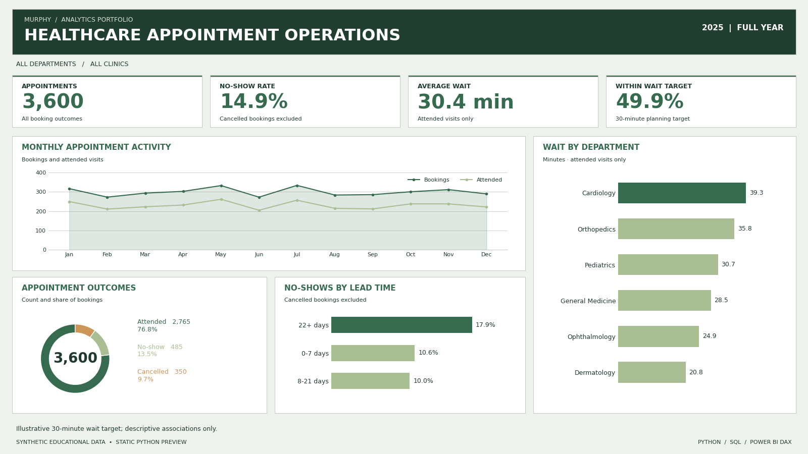

# Healthcare Appointment Operations

Healthcare appointment analysis using Python, SQL and Power BI DAX: no-shows, booking lead times and waiting-time performance. Includes synthetic data, interactive dashboard, preview and documentation.

**Level:** Entry–intermediate · **Period:** 2025 · **Tools:** Python, pandas, Matplotlib, SQLite, Power BI DAX, HTML/CSS/JavaScript

## Dashboard preview



## Business question

Where do appointments fail to convert into attended visits, and which departments have longer queues?

## Dataset and provenance

3,600 appointments across six departments and three clinics. One row represents one booking; patient IDs may recur. Department targets live in a separate six-row lookup.

[python/generate_data.py](python/generate_data.py) creates the inputs with a fixed random seed. No external dataset or real personal information is used. Raw inputs remain separate from derived [data/processed.csv](data/processed.csv). Generator assumptions are documented in the [Word handbook](docs/Project_Handbook.docx).

## Skills demonstrated

| Area | Implementation |
|---|---|
| Data quality | Unique IDs, missing-value rules, date validation and foreign-key checks |
| Python | Reusable metric functions, pandas aggregation and reproducible charts |
| SQL | Joins, conditional aggregation, CTEs, safe division and window functions |
| Reconciliation | SQL versus pandas checks for annual, monthly and department metrics |
| Testing | Boundary tests for cancellations, empty periods and wait thresholds |
| Visualization | Offline HTML filters and a static dashboard preview |
| Power BI preparation | DAX measures, date-model instructions and an importable theme |

## Key results

| Metric | Result |
|---|---:|
| Appointments | 3,600 |
| Attended | 2,765 |
| No-shows | 485 |
| Cancelled | 350 |
| No-show rate | 14.9% |
| Average attended wait | 30.4 minutes |
| Within planning target | 49.9% |

## Findings and recommendations

- Of 3,600 bookings, 2,765 were attended, 485 were no-shows and 350 were cancelled. The no-show rate is 14.9% of 3,250 eligible appointments; its share of all bookings is 13.5%. These figures have different denominators.
- Average attended-visit waiting time is 30.4 minutes. Only 49.9% of attended visits meet the analyst-set 30-minute planning target.
- Cardiology has the longest average wait at 39.3 minutes; Dermatology averages 20.8 minutes. Review demand, staffing and arrival patterns before proposing changes.
- Appointments booked 22 or more days ahead have a 17.9% no-show rate, versus 10.6% for 0–7 days and 10.0% for 8–21 days. The pattern is not strictly monotonic.

Recommended next steps:

1. Investigate Cardiology and Orthopedics queue patterns by clinic and day, using a real operational dataset before changing staffing.
2. Design a reminder pilot for longer-lead bookings and evaluate attendance with an appropriate comparison group; do not claim savings from this synthetic analysis.
3. Monitor the same definitions monthly, reporting booking outcomes separately from the attended-only waiting-time measures.

## Metric definitions

No-show rate = no-shows / (attended + no-shows). Cancelled bookings are excluded. Waiting-time averages and the 30-minute planning target apply to attended visits only. The donut shows shares of **all** bookings, so its no-show share (13.5%) differs from the operational no-show rate (14.9%).

The 30-minute target is an analyst-set simulation assumption, not a clinical standard. Reminder comparisons are descriptive and do not establish causation.

## Repository contents

| Folder or file | Purpose |
|---|---|
| `data/` | Raw CSVs and a regenerated processed dataset |
| `python/analysis.ipynb` | Executed exploratory notebook with charts |
| `python/run_all.py` | Analysis, reconciliations and visual rebuild |
| `sql/analysis.sql` | Six executed SQLite analysis queries |
| `tests/` | Four meaningful metric-boundary tests |
| `dashboard/` | Offline dashboard and reusable HTML template |
| `reports/` | Preview, metrics, validation log and six SQL result tables |
| `powerbi/` | DAX measures, model expressions and theme |
| `docs/Project_Handbook.docx` | Findings, dictionary, methodology and Power BI guide |

## Reproduce the analysis

From the repository root:

```bash
python -m pip install -r requirements.txt
python python/run_all.py
python -m unittest discover -s tests -v
```

No database server is required; the SQL runner uses SQLite from Python's standard library. The pipeline validates inputs, executes six queries, reconciles annual, monthly and department metrics against pandas, and regenerates the processed CSV, dashboard and PNG preview.

To regenerate the same input fixture:

```bash
python python/generate_data.py
python python/run_all.py
```

This overwrites input CSVs with the deterministic synthetic dataset. To explore interactively, open `python/analysis.ipynb` using JupyterLab from the repository root or `python/` directory. JupyterLab is an optional separate installation.

## Dashboard controls

Filter by quarter, department and clinic. Reset restores the full year. The compact desktop layout targets 1440 × 900 and larger content areas; the verified PNG preview is exactly 1600 × 900. Smaller screens use a scrolling layout.

Every chart uses the selected appointment-date period.

## Power BI deliverables

- [Measures](powerbi/measures.dax)
- [Calendar and model expressions](powerbi/model.dax)
- [Color theme](powerbi/theme.json)
- [Detailed build guide in the Word handbook](docs/Project_Handbook.docx)

**Native `.pbix` files are not included.** DAX and themes have not been executed in Power BI Desktop. The completed interactive dashboard is HTML. Relate Calendar to appointment_date, not booking_date.

## Validation and limitations

See [reports/validation.txt](reports/validation.txt). Four boundary tests pass. Python and SQLite results reconcile at annual, monthly and department levels. The notebook contains saved execution outputs.

All records are generated for education. Apparent relationships partly reflect explicit generator assumptions and are not evidence about a real organization. The projects are descriptive, with no prediction model or causal inference. No clinical outcomes, diagnoses, staffing rosters or financial costs are available.

## License

[MIT](LICENSE)
